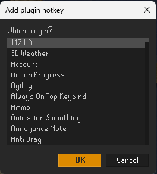
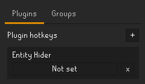
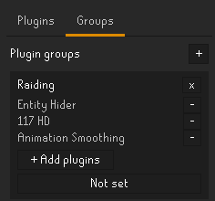

# RuneLite Plugin Toggler

Give any of your RuneLite plugins its own hotkey that turns it on and off, or put several plugins in a group and
turn them all on and off with one key. Hide entities with a tap, switch an overlay off for a boss, bring it back
after. It only reacts to your key presses: it never clicks or moves for you.

## Turn a plugin on and off with a key

Open **RuneLite Plugin Toggler** in the sidebar (the green switch), and press **+** on the **Plugins** tab. Pick any
plugin you have installed, built in or from the Plugin Hub.

Then click the key button on its row and press the key you want. Combos like Ctrl+E work, and Esc clears the key.
Press that key any time to turn the plugin on or off. The **x** removes the row.

## Groups

The **Groups** tab turns several plugins on and off together with one key.

1. Press **+**, name the group, then tick the plugins that belong in it.
2. Set its key the same way as for a single plugin.
3. Press the key: if any plugin in the group is on, they all turn off. If none are on, they all turn on.

Use **+ Add plugins** to add more, the small **-** to take one out, and **x** to delete the group.

## Remembering across sessions

Each entry has a setting for what happens to the plugin's on/off state:

- **Remember across sessions** (the default): the plugin is switched on or off in RuneLite and kept that way. Turn
  Entity Hider off with your key before a raid, log out, come back later, and it is still off.
- **This session only:** the plugin is only stopped or started for now, and reverts to the way RuneLite has it saved
  after a restart. A plugin that is switched off in the plugin list is switched on for now and put back to off when you
  turn it off again or close RuneLite.

## Each entry

Every row has a coloured dot (green on, red off, amber when only some of a group are on) and a sliding **ON/OFF**
switch. ON turns the plugin on and lets its key work. OFF turns the plugin off and makes its key do nothing, without
deleting the entry. Small arrows reorder the rows. The **+** picker has a search box. **Export** and **Import** at the bottom of the panel copy your hotkeys and groups as text, to
back them up or move them to another computer.

## Knowing what it did

When you press a key, the plugin tells you what it turned on or off, so you're never guessing:

- **Chat message:** for example "Plugin Toggler: Entity Hider turned on." or "Raiding group turned off: Entity Hider,
  117 HD."
- **On-screen popup:** a small text for a few seconds, green for ON and red for OFF. Hold **Alt** and drag it where you
  want it (a "drag me" sample shows while Alt is held).

Both can be switched off, and the popup time changed, in the plugin's settings.

## Features

- Works with any installed plugin, and does the same thing as clicking its switch in the plugin list, so the plugin's
  own settings are untouched.
- Doesn't interrupt gameplay: the plugin list's search box doesn't grab the keyboard when you toggle.
- Your keys and groups are remembered between sessions.
- Plugins that can't be turned off aren't offered.

## Tips

- Use F-keys or a modifier combo (Ctrl, Alt, Shift) rather than a plain letter, since a plain letter also fires while
  you type in chat.
- Give each key to one plugin or group only.
